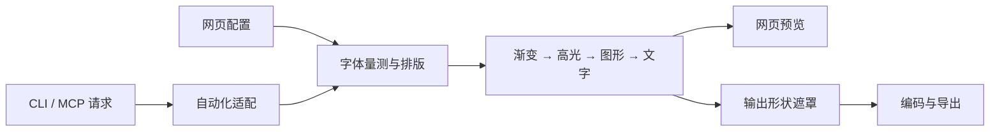

# 架构

网页是静态应用。浏览器根据一份头像配置生成渐变、图形和文字，再编码成图片。CLI/MCP 通过 Chromium 调用同一套绘制与编码模块，使用独立的 v1 请求格式。

## 模块与数据流

技术栈为 React、TypeScript、Vite、Tailwind CSS、Base UI/shadcn 和 zustand；具体版本以 package-lock.json 为准。

| 路径 | 职责 |
| --- | --- |
| `src/app/` | 预览、工作台、选择器、导出和更新提示 |
| `src/state/` | 配置、归一化、撤销重做、本地历史 |
| `src/engine/` | shader 参数、种子、渲染及设备上限 |
| `src/text/` | 字形量测、自动排版、圆裁、文字绘制 |
| `src/graphics/` | 品牌、内置图标、emoji、上传与绘制 |
| `src/fonts/` | 字体目录、加载、预览与会话上传 |
| `src/palettes/` | 内置配色和 OKLCH 颜色计算 |
| `src/export/` | 合成、编码、下载与图片剪贴板 |
| `src/automation/`、`service/` | v1 输入、Logo 处理、CLI/MCP 和浏览器 runner |
| `src/about/`、`about.html` | 独立简介页 |

预览使用多层画布，导出由 `composeWith` 统一合成。两者复用布局和绘制函数；形状遮罩最后执行。字体加载完成后才量测与出图。排版参数和几何约束见[排版参考](layout.md)。

四种质感的参数映射集中在 `src/engine/styles.ts`：mesh 对应 staticMeshGradient，flow 对应 meshGradient，silk 对应 warp，grain 对应 grainGradient。无 WebGL2 时采用相同种子的 2D 近似，并提示用户。设备渲染上限低于输出尺寸时先按上限渲染再放大。

## 配置与存档

网页配置定义在 `src/state/config.ts`。共享默认值集中在 `DEFAULT_CONFIG`；加载时通过 `normalizeConfig` 补缺失字段、校验枚举并限制数值范围。默认内容为「工作新习惯 / 你说豆包干」、豆包工作图标、钢灰深色背景、白色文字、投影 0.4、光感 0.08。主行 Noto Serif SC 700，副行 Noto Sans SC 700。

首次进入和重置采用默认配置。已有存档的显式值保留，包括纯色效果和零强度；缺失效果字段补投影。旧默认与用户主动选择没有独立标记，因此不按值猜测迁移。网页配置与自动化请求格式不同，后者见[自动化指南](automation.md)。

| 字段 | 内容 |
| --- | --- |
| text、seed | 两行文字与背景种子；网页空种子由文字派生 |
| style、styleParams、highlight | 质感、参数与高光 |
| palette、customColors | 内置配色 ID 或自定义颜色 |
| canvas | 尺寸、形状与圆角 |
| typography | 两行字体、字号、位置，共用边距、行高、颜色和效果 |
| layout | Logo 来源、大小和位置 |
| exportOptions | 格式、体积目标和底色 |

配置按 300 ms 去抖保存至 localStorage 的 `gradient-avatar:v4`。页面隐藏、离开和明确刷新时同步待写状态；权限、配额、浏览器清理或强杀仍可能导致丢失。历史最多 8 条，按配置哈希去重。导出动作记录开始时的配置快照，缩略图按哈希回填并带版本，缓存失效不删除历史配置。

上传图形和字体字节保存在会话注册表；存档只记录引用，刷新后须重新上传。参考线、主题和手机预览高度属于界面偏好，不进入图片配置。

## 素材与字体

品牌清单在 `scripts/brand-list.json`。生成器处理源文件并输出 `public/brand/` 与懒加载索引；稳定 ID 和可选资源名 `asset` 分离，换素材时更新资源路径。图片按可见像素测量，东黎保留品牌留白。来源与许可见[素材说明](assets.md)。

SVG 上传采用白名单重建，作为图片解码。网页单文件上限 5 MiB，扫描前限制 16 Mi 像素；会话最多 24 份、64 Mi 像素。首次解码的峰值仍由浏览器管理。生成期可展开源文件内部 use 和简单类样式，运行时输入仍受净化器约束。自动化采用更严格的独立限制。

默认字体从本站按 unicode-range 分片加载。其他字体依次尝试 Google Fonts、jsDelivr fontsource 镜像和备用镜像，失败后使用系统字体并提示。字体目录缓存 7 天。正文字体请求不携带用户文字的 text 参数；字体名预览使用独立别名和显示名子集，避免污染正文加载状态。上传字体仅在本会话注册。

## 界面与异步结果

桌面按宽度呈现两列或三列，手机为纵向页面。手机预览可调高度；文字、Logo 的大小和上下位置常显，字体与低频设置折叠。手机精调用数值和加减，桌面提供滑块。预览提示的高度参与布局计算。

图形、字体、历史和导出控件按需加载。导出抽屉外壳常驻，使首次打开也经过关闭到打开的动画状态。减少动效偏好只缩短动画，不改变布局。

手机长按图片与导出结果绑定配置身份。编辑后立即隐藏旧结果，待最新编码完成再显示；编码单在途，只保留最新待办。编码结果按实际 Blob MIME 决定扩展名；PNG 按无损结果处理。

## 构建与运行边界

`npm run build` 生成 `dist/` 的 `/` 与 `/about` 两个入口。PWA 预缓存随构建生成；页面每 15 分钟及回到前台时检查更新，用户确认刷新前同步存档。静态站发布见[部署](deploy.md)。

`npm run build:service` 生成 `dist-service/`。CLI/MCP runner 使用有界队列和每请求隔离的浏览器 context，仅加载构建资源。HTTP 认证、限流和兼容性见[自动化指南](automation.md)。

隐私和安全报告方式见 [SECURITY](../SECURITY.md)。
