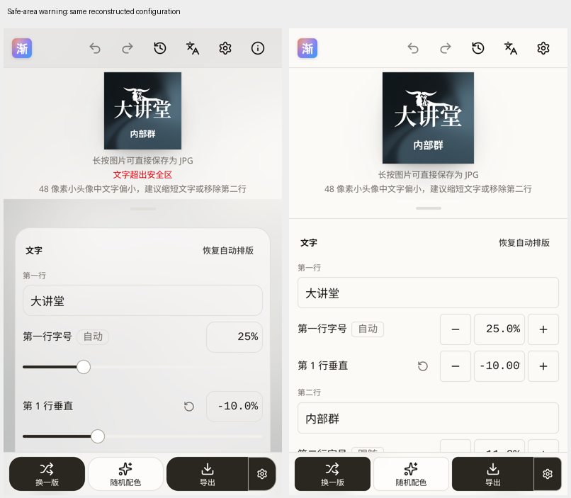
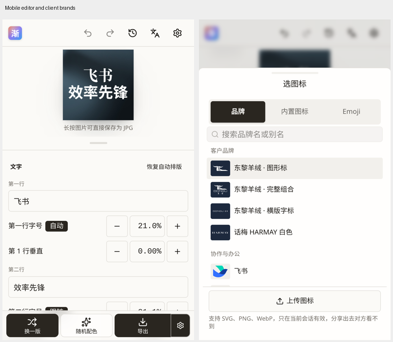

# 手机编辑与安全区复核（2026-11-07）

## 原图与重建

用户 646.jpg（Library libfile_19a86d6542788191a0097e43ff20b34e）显示“大讲堂 / 内部群”、东黎图形标、矩形安全线和圆裁线，红色“文字超出安全区”及独立灰色 48px 小字提示。647/648 为编辑区与品牌选择器的真实手机截图。本轮已经下载并逐张查看；截图不含存档配置，复现是同款文字和素材的重建，非逐值恢复。

当前旧站 main-DpNd5b_Q.js 实测红色告警 1 条。重建主行 25%、副行 11%、边距 6%、Logo 30%，上下偏移 -10% / +10%：最终所有元素位于安全矩形中，但 fitStack 的临时文字区高度与对称余量判据得到 fits=false。旧告警混用了这个中间结果。修复使用最终逐行框和图形框；自动及圆图按圆弧，手动方图按矩形。12 组有无 Logo 与位移复现，行坐标及图形坐标逐值相同。最终提示还在光学补偿及整体放大后按用户实际边距重算，避免把自动布局内部 6% 的计算基线当成用户 3% 的安全线。灰色提示依据 48px 下的字体大小，副行 11% 约为 5.3px，保留此独立诊断。

## 手机改动

去掉编辑区卡片及装饰背景，单层 12px 页面内距；常用参数改减/数值/加（数值立即反馈，不做弹簧插值），字体低频折叠，背景连续参数仍有滑块。iPhone 15 / SE Chromium 模拟实测常用参数行高 44–48px，按钮 44px，页面无横向溢出。数字精度覆盖字号 0.5%、位移 0.25% 步进。客户品牌默认前置，HARMAY 与东黎实际源文件颜色可选，设置内简介新标签打开。

素材逐项扫描与限制：[69 条目 / 80 文件](2026-11-07-brand-assets.md)。控件研究与局限：[OKF 记录](../research/avatar-optical/mobile-editor.md)。真实触控模拟覆盖加、输入、恢复自动、客户选择及颜色切换；简介验证键盘 Enter、新标签、opener 隔离、原文本保留。

## 验证边界

未在实体 Safari 或飞书客户端重测；无真人任务计时，不宣称使用效率已被实验验证。布局校验仍以逐行边界和品牌保留框作保守检查，不是逐个笔画像素碰撞。阴影、描边等装饰不是本轮新校验目标。品牌审计证明文件解码与颜色事实，不构成逐品牌使用授权；其余品牌缺少明确合规黑白素材的情况已逐项记录。

## 发布前验证

- lint、format:check、typecheck、858 项单元测试（75 文件）、网页 build、服务 build 和 3 项 HTTP 服务测试通过；7 项服务集成测试已覆盖本轮 CLI/MCP 预设变更。
- 全量浏览器 57 项中，56 项通过，1 项旧测试仍寻找已替换的手机滑块；改为实际点按步进。中间构建的相关 12 项复测全部通过，包括该用例、安全区、手机数字输入、客户选择、设置及新标签。按需加载列表的等待改为等待实际选项，保留冷启动时序证据。
- 逐项品牌扫描 69 条目 / 80 文件全部解码成功。实际 CLI 输出 HARMAY 白色 PNG 样例，主行中文衬线、副行无衬线均加载成功；保留扁宽字标与 48px 副行可读性诊断。
- 首屏压缩 JS 281.98 KB，预算工具的 250 KB 参考线仅作提示，本轮未扩大为打包重构。

附件服务在 tools/list 阶段返回 HTTP 401，未创建 Library 文件。三张复核图及 CLI 样张纳入 Git，源输入截图不公开提交。

随后英文单行截图暴露绘制起点不等于可见墨迹左边界：最终浏览器校验需使用 TextMetrics.actualBoundingBoxLeft/Right 及真实上下边界，不能把 advance 原点与墨迹宽度拼接。该修复只影响诊断，不移动文字。

最终墨迹校验与即时数字反馈构建：10 项专项浏览器回归通过（桌面/手机的中文误报、真实越界、英文单行、简介新标签，以及手机精调/恢复自动/客户颜色）。全量单测 858 项通过。

实际 CLI 原尺寸输出：[HARMAY 白色字标与双行中文](../assets/reviews/v8.4.0-harmay-cli.png)。

`npm run screenshots -- --url http://127.0.0.1:4173/?lang=zh-CN` 完成 16 张最终截图，逐张复核桌面、iPhone 15、iPhone SE 明暗主题、整页与导出状态。未见新的遮挡或横向溢出。相关代码、SDD、研究与长期记忆同步，无本轮已知文档债务。
