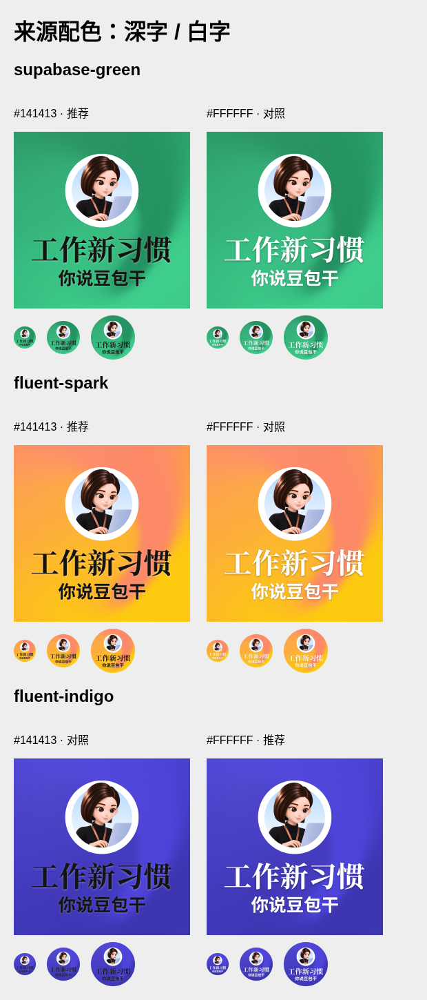

# v8.11.0 配色验收

范围：三组新增配色及参考线说明。默认头像、客户素材与布局算法保持原值。

## 已测视觉

实际导出 36 张 256² 背景，涵盖四质感、三个种子、默认光感；每套推荐字色的全画面最低对比均大于 4.5。另导出六张 512² 头像，查看深浅字、32/48/64 px 圆裁。颜色与局限见[研究记录](../research/avatar-optical/source-palettes.md)，原始结果见 [JSON](../assets/source-palettes/metrics.json)。

网页选色保留当前文字色，自动化入口采用配色推荐字色。浅底用白字、深靛用深字的对照辨认度明显下降；投影不替代合适的字色。32 px 副行细小，未进行飞书客户端或真人可读性实验。

## 编辑器检查

在 1440×900 桌面和 390×844 手机视口逐一选择三组配色，调整为推荐字色并实际编码；两端均无 JavaScript 异常或横向溢出。该交互检查将输出尺寸设为 512 px，其余默认内容与投影保留。已查看[桌面](../assets/source-palettes/ui-desktop.png)和[手机整页](../assets/source-palettes/ui-mobile.png)截图。

首轮发现配色增加到九行后桌面列溢出 9 px；仅收紧桌面纵向间距 2 px，原首屏回归断言重新通过。手机间距与所有色块尺寸不变。

## 工程验证

Node 24.22.1、Chromium 软件渲染环境：

- `npm run check`：lint、格式、类型检查、77 个文件中的 915 项单测、网页构建、3 项服务单测及服务构建全部通过。
- `npm run test:service:integration`：7 项通过，包括官方 SDK 的 HTTP/stdio 客户端及 CLI 批量出图；选项清单为 51 套。
- `npm run e2e -- --workers=1`：完整 85 项通过，耗时 23.3 分钟。
- `scripts/audit-source-palettes.mjs`：独立复跑的 36 张背景、6 张头像测量与首次结果一致。

首次双 worker 运行在复制、刷新存档两项超时；改单 worker 后两项及完整套件通过，未放宽断言。服务集成测试在本云环境中显式关闭 Chromium 沙箱，产品运行默认未改；本轮不验证容器生产沙箱。

参考圈公式经代码核查；网格状态持久化且不进入导出的浏览器用例通过。本轮未修改圆裁或排版算法。发布版本为 v8.11.0；远端提交与线上产物按[发布核验](../deploy.md#发布核验)检查，具体上线结果随交付报告提供。
