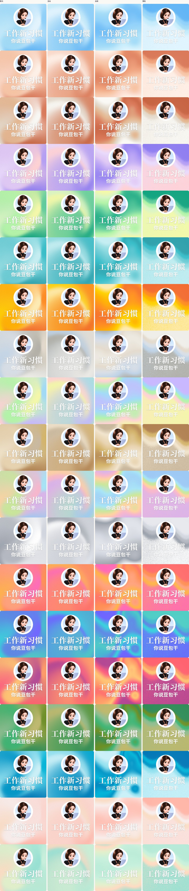
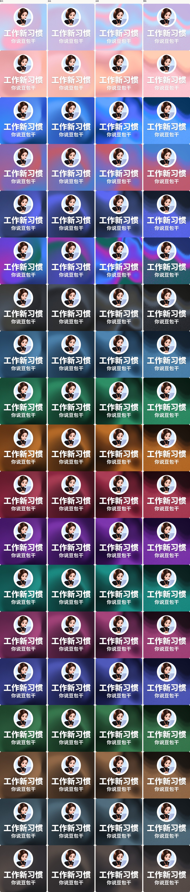
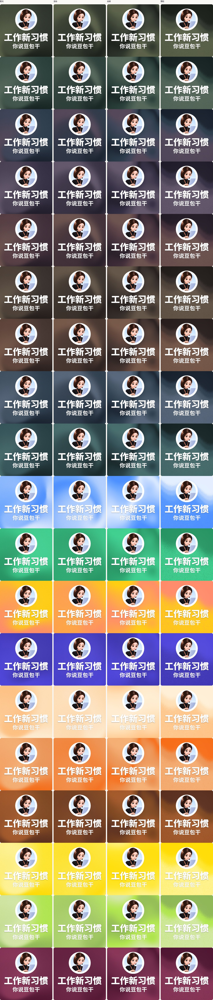
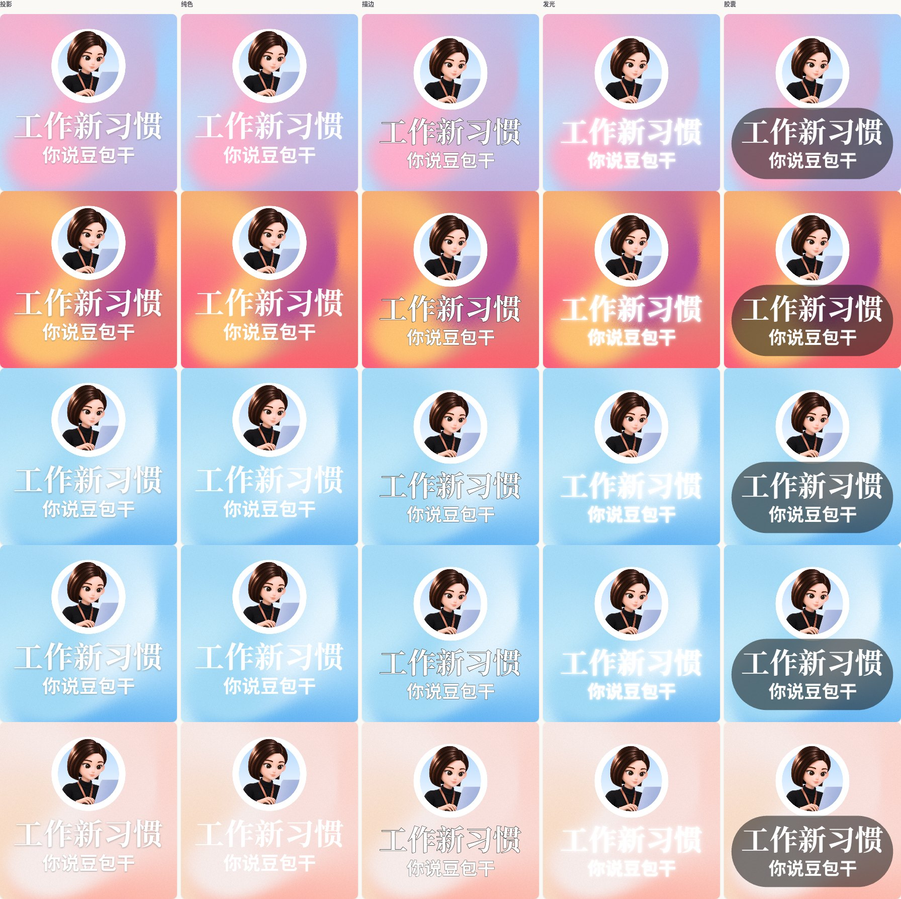

# 样张

样张由实际导出管线生成。查看时请同时观察完整图与聊天列表中的小尺寸效果。

在仓库根目录运行 `npm run samples` 可重建这些图片；需要已安装 Playwright Chromium。

## 来源配色

[深浅文字与小尺寸圆裁对照](assets/source-palettes/comparison.png)，[来源及测量](research/avatar-optical/source-palettes.md)。翠绿、杏金推荐深字，深靛推荐白字。
